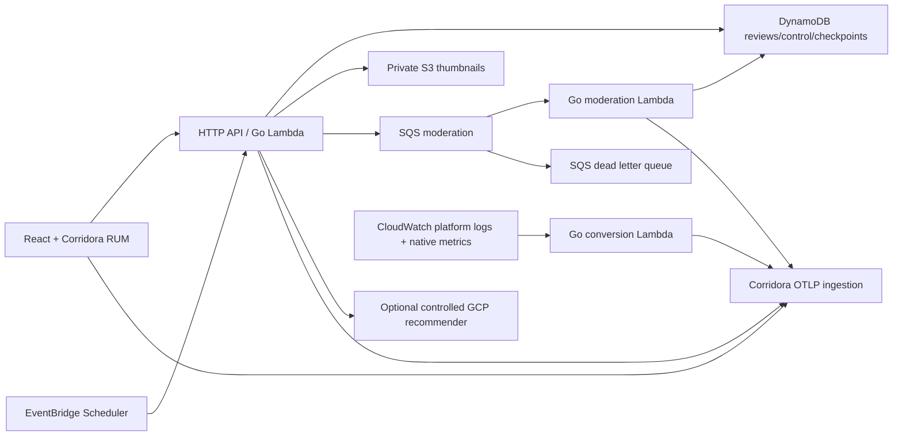

# Trace Reviews

Published 2026-10-11 · Updated 2026-10-11

A standalone React/Vite and Go sample for Corridora. Submit a fictional product
review, watch queue moderation, and investigate a bounded daily schema regression.
The same Go handlers run locally and behind an AWS HTTP API/Lambda deployment.
All sources belong to the MIT-licensed `corridora/sample-reviews` repository.



## Start locally

Requirements on macOS/Linux: Python 3.11+, Go 1.26.4, Node.js 22.12+ (24 recommended), npm.
`./setup --help` only needs Python. Setup never asks for an AWS password.

```sh
./setup
```

The wizard configures keys and a scenario token, installs locked npm dependencies,
builds React and Go, starts the server, runs a real Chromium journey, then leaves
the app running at **http://127.0.0.1:4102**. Install the browser once if needed:

```sh
npm ci --ignore-scripts
npx playwright install chromium
```

Run each step separately when preferred:

```sh
./setup configure
./setup deploy --plan
./setup deploy
./setup run
# In a second terminal, while the server is running:
./setup verify
./setup scenario --phase regression --duration 180
./setup scenario --phase recover --duration 180
```

Local mode uses bounded in-memory data and a three-attempt queue simulator; a restart
clears it. It needs no AWS signup or cross-cloud dependency. Corridora keys may be
blank locally, but export and browser correlation are then unverified. Use your own
tenant by default; maintained Demo deployments require an operator's two scoped keys.
Follow [Set up Corridora](docs/corridora-setup.md) for the exact instrumentation,
origins, verification and rotation steps.

## What to investigate

Every request and queued message derives the daily **13:20–13:30 UTC** window from
the clock, even if a scheduler misses its invocation. A simulated `schema-v2` change
rejects only **Trace headphones / `demo-product`** moderation. The worker retries
twice after the initial attempt; the third failure marks the review `failed` and SQS
redrives the message to its DLQ. **Signal speaker / `control-product`** stays healthy.
`failed` indicates exhausted moderation attempts; it does not prove SQS has already
completed the asynchronous move. Inspect the DLQ separately.

An authenticated override expires after 1–600 seconds. `recover` creates a healthy
override with the same bounded expiry. Expired overrides revert to the current
clock-derived phase. `demo.release` identifies the simulated change; `service.version`
continues to identify the actual built source digest.

`scripts/journey.mjs` uses the visible form through healthy → regression → healthy
control → recovery, writes screenshots and trace IDs to ignored `test-results/`,
and persists a browser heartbeat. It never exposes the control token to page JavaScript.
Cloud moderation can take ~60–120 seconds because Lambda polls SQS; the browser
allows 130 seconds for the failed status. The scenario duration is 180 seconds.

## AWS setup and cost

Signups: an AWS account with billing enabled; a Corridora organization; optional
GitHub repository access for scheduled browsers. Authenticate with an existing AWS
CLI v2 profile, typically `aws sso login --profile <profile>`. Deployment also needs
permissions for CloudFormation, IAM role creation/pass-role, Lambda, HTTP API,
DynamoDB, S3, SQS, Scheduler, Secrets Manager and CloudWatch configuration.
When enabling synthetics, install/authenticate GitHub CLI (`gh`) with repository
Actions variables/secrets/workflow permissions and publish the included current
daily workflow to the selected repository's `main` branch first.

Select `cloud` in `./setup configure`; provide the profile, region (`us-east-1` by
default), dedicated stack prefix, two scoped Corridora keys, and optional features.
Resource reuse means rerunning the **same owned stack** with its inventory. Other
existing queues/buckets/tables are deliberately not adopted. You may select an existing
**dedicated** Secrets Manager ARN, which is updated with this sample's configuration
and is preserved on teardown. Never select a shared application secret.

```sh
./setup deploy --plan
./setup deploy
./setup run
./setup verify
```

`infra/template.yaml` is native CloudFormation, with actual deployment through the
AWS CLI. Setup builds a Linux/arm64 `provided.al2023` bootstrap, packages React assets,
creates a private owned artifact bucket, uploads the zip, applies the stack, writes
the secret from a protected file, and updates a configuration revision to recycle
Lambda's cached secret. Cloud `run` checks health and prints the deployed HTTPS URL.
No NAT, VPC, load balancer, frontend hosting plan, or always-on collector is required.

Plan **$1–3/month before tax**, under 100k small requests, 0.5 GB egress and 50 MB
CloudWatch logs. This includes a $0.40/month secret, small S3/SQS/DynamoDB usage, and
optionally four CloudWatch queries every 15 minutes (about $0.12/month at $0.01/1k).
AWS quotas/free allowances are account-scoped; introductory credits are not assumed.
Traffic, log volume and export egress can exceed this estimate. Configure AWS billing
alerts and review usage before enabling optional synthetics/forwarding. API throttles
at 5 requests/second with burst 10; concurrency is bounded, logs retain 3 days,
reviews/checkpoints/objects/builds expire after 7 days, queues retain 1 day.

## Cross-cloud endpoints

Set `RECOMMENDER_URL` to a controlled HTTPS **origin**. Reviews calls its
`/api/recommendations?product_id=demo-product` with a 1.5-second timeout, no redirects,
explicit W3C injection, and optional dedicated `DOWNSTREAM_AUTH_TOKEN`. The exporter
and control keys never go to dependencies. Blank selects a deterministic local fixture.

The AWS endpoints for other samples are leaves and never call the recommender:

```text
GET /internal/review-summary?product_id=demo-product
{"product_id":"demo-product","rating":4.5,"count":12}

GET /internal/price-fixture
{"prices":{"DEMO":42.5,"CLOUD":17.25,"TRACE":9.75},"fictional":true}
```

If configured, the dedicated downstream token protects both leaves. The summary is a
stable seeded product fixture; it is separate from newly submitted moderation records.
There are no real Meta/Google advertising tags or personal reviews in this app. The
fleet's gallery/tutorial examples provide controlled tracker scenarios.

## Daily execution and watchdog

`ENABLE_SYNTHETICS=true` installs an EventBridge Scheduler API probe at the configured
UTC start and an API watchdog at 16:00 UTC. Both enqueue the affected review and a
healthy control. The watchdog opens a fresh bounded override if the day's browser
heartbeat is missing. An API probe is recorded with `browser=false` and never satisfies
the browser heartbeat requirement.

With cloud `ENABLE_SYNTHETICS=true`, setup also asks for
`SYNTHETIC_GITHUB_REPOSITORY=owner/repo`. Deploy preflights the published workflow,
installs owned repository variables `ENABLE_SYNTHETICS=true`,
`SAMPLE_URL=<deployed URL>`, `SAMPLE_REVIEWS_OWNER=<inventory owner>`, writes the
`DEMO_CONTROL_TOKEN` secret through stdin and enables `.github/workflows/daily.yml`.
It blocks clearly before AWS mutations if the current workflow isn't published,
GitHub CLI access is missing, or another inventory owns the configuration.
Its 13:20 UTC run opens a bounded override and runs the real browser journey. Its
16:30 UTC watchdog checks the persisted heartbeat and replays the same complete
browser journey if today's successful evidence is absent. Scheduled GitHub Actions can
be delayed or dropped and disable after 60 days without public-repository activity.
For a dependable every-day operation, also run this script from the fleet's persistent
runner and alert on missing heartbeat; a hosted daily incident has not been validated
merely by shipping these schedules. Keep browser execution to one process and short
artifact retention. Configure workflow schedules too if changing the UTC daily start.

## Validation

```sh
npm ci --ignore-scripts
npm run build
go test ./... -count=1
python3 -m unittest discover -s scripts -p 'test_*.py' -v
go vet ./...
./setup --help
./setup deploy --plan
```

Tests use mock keys and local HTTP servers, checking W3C extraction, sampled decisions,
queue attributes/consumer context, partial batch failures, failure expiry/recovery,
auth, all three OTLP protobuf envelopes, CloudWatch timestamps/checkpoints and owned
setup plans. No test sends to Demo.

To validate browser correlation offline, supply an actual Corridora RUM distribution:

```sh
RUM_BUNDLE_PATH=/absolute/path/corridora-rum.js python3 scripts/local-validation.py
```

This starts an isolated Go app and local OTLP sink, loads the real RUM distribution
before React, exercises the form, and asserts captured RUM CLIENT → Go SERVER
parentage plus logs/metrics. A manually generated `traceparent` is insufficient.
The test requires Chromium (cached compatible browsers are discovered automatically)
and never forwards records from the sink. Evidence is in `test-results/journey.json`;
the private `.local/capture.ndjson` contains captured telemetry. Without a real bundle,
this command stops and asks for its path rather than substituting a fake tracer.

Live AWS IAM, CloudFormation acceptance, SQS delivery/DLQ timing, Scheduler delivery,
CloudWatch subscription/poll results, hosted daily evidence, actual billing, and stored
Corridora tenant parentage still need deployment/operator checks. See the guide.

## Rerun, replay and teardown

Configuration, secrets, ownership inventory and discovered resource outputs are stored
in ignored `.local/` files with owner-only permissions. Keep the inventory to resume
partial provisioning; losing it prevents automatic adoption/deletion of resources.
`./setup configure --non-interactive` accepts environment variables or `--config` JSON;
secret-containing input files must be chmod 600. Noninteractive cloud deploy/teardown
uses `--yes` only after reviewing `--plan`. There is no secret command-line flag.

```sh
./setup scenario --phase recover --duration 180
./setup scenario --replay-dlq     # at most one message, cloud only
./setup destroy --plan
./setup destroy
```

DLQ replay preserves message context, sends before deleting, and is safe if repeated
after approval. Recover before replaying. Destroy verifies account, region, stack and
resource owner tags; empties owned S3 buckets, deletes the owned stack and build bucket,
and preserves a selected external secret. Local destroy removes saved configuration;
stop a foreground local process with Ctrl-C.
An installed owned GitHub browser workflow is disabled and its written variables/control
secret are removed; the repository itself is preserved. A CloudFormation stack in
`ROLLBACK_COMPLETE` may require reviewing `destroy --plan`, destroying the failed owned
stack, and redeploying; the inventory is kept through these failures.

Implementation and pricing references: [Go OTel exporters](https://opentelemetry.io/docs/languages/go/exporters/),
[Go Lambda packaging](https://docs.aws.amazon.com/lambda/latest/dg/golang-package.html),
[SQS partial failures](https://docs.aws.amazon.com/lambda/latest/dg/services-sqs-errorhandling.html),
[Scheduler targets](https://docs.aws.amazon.com/scheduler/latest/UserGuide/managing-targets-templated.html),
[Secrets Manager pricing](https://aws.amazon.com/secrets-manager/pricing/),
[CloudWatch pricing](https://aws.amazon.com/cloudwatch/pricing/),
[HTTP API pricing](https://aws.amazon.com/api-gateway/pricing/),
[GitHub scheduling limits](https://docs.github.com/en/actions/reference/workflows-and-actions/events-that-trigger-workflows#schedule).
GitHub setup uses [CLI variables](https://cli.github.com/manual/gh_variable_set),
[secret stdin input](https://cli.github.com/manual/gh_secret_set) and
[workflow enable](https://cli.github.com/manual/gh_workflow_enable).
